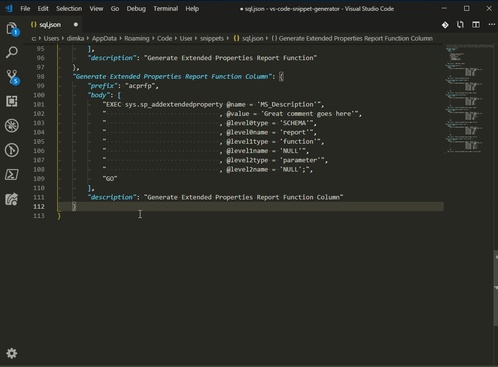

# VS Code Snippet Generator

Turn selected text into a VS Code snippet - as a JSON block to paste somewhere
yourself, or saved straight into user or workspace snippets for the languages
you pick. All commands are prefixed **Snippets Generator:** in the command
palette and appear in the editor right-click menu while text is selected.

## Commands

### Snippets Generator: Generate snippet JSON block

Select text, run the command, answer the name/prefix/description prompts, and
the selection is replaced with the snippet JSON block, ready to paste into any
snippets file.



### Snippets Generator: Save snippet to snippets file

Select text, run the command, answer the same prompts, then:

* **Pick language(s)** - the current file's language is detected automatically,
  listed first and pre-selected; pick as many as the snippet should apply to.
* **Pick the target** - user snippets or the workspace `.vscode` folder
  (see [Where snippets are saved](#where-snippets-are-saved)).

Existing comments in snippet files are preserved, and you are asked before an
existing snippet with the same name is overwritten.

### Snippets Generator: Wrap selection as tabstop placeholder

Select the part of a snippet body that should become a placeholder and run the
command - the selection becomes `${1:selected text}`, numbering continues from
the highest tabstop already in the file. Works with multiple cursors.

### Snippets Generator: Manage saved snippets

Browse your snippet files (user + workspace), pick a snippet, then jump to it
in the editor or delete it.

## Where snippets are saved

| Choice | File | Loaded by VS Code |
|---|---|---|
| User, one language | `<user profile>/snippets/<language>.json` | everywhere, every workspace |
| User, several languages | `<user profile>/snippets/<name>.code-snippets` with a `"scope"` | everywhere, every workspace |
| Workspace | `.vscode/<name>.code-snippets` with a `"scope"` | only in that workspace - but shared with your team via the repo |

A snippet for several languages cannot live in a single `<language>.json`
file, which is why those saves ask for a `.code-snippets` file name.

> **Remote sessions (SSH / WSL / containers):** the extension runs on the
> remote machine, so "User snippets" means the *remote* profile - VS Code does
> not load user snippets from there, and the target picker warns you about it.
> Use the Workspace target when connected remotely; user snippets work as
> expected when the extension runs on your desktop.

## Settings

### `vs-code-snippet-generator.indentation` (default: `"dedent"`)

How the leading whitespace of the selected lines is turned into the snippet
body. Given this selection from inside a nested block:

```js
        if (x) {
            y();
        }
```

| Value | Body lines | Effect |
|---|---|---|
| `"dedent"` | `if (x) {` / `    y();` / `}` | strips only the indentation **all** lines share - relative nesting survives |
| `"trim"` | `if (x) {` / `y();` / `}` | strips **all** leading whitespace - nesting is flattened |
| `"preserve"` | unchanged | keeps every line exactly as selected, including the original deep indent |

`dedent` is what you want almost always: the snippet inserts flush with the
cursor and re-indents naturally.

### `vs-code-snippet-generator.escapeSnippetSpecialCharacters` (default: `false`)

In snippet bodies `$` starts a tabstop or variable (`$1`, `${2:x}`, `$HOME` is
read as a snippet variable!) and `\` is the escape character. By default the
selected text is taken as-is, so you can hand-edit tabstops into the body
afterwards - but it also means shell/PHP/template-literal code inserts wrong.

Enable this setting to escape both characters so the snippet reproduces the
selection literally:

| Selected | `false` (default) | `true` |
|---|---|---|
| `echo $HOME` | `echo $HOME` → inserts `echo ` (eats `$HOME`) | `echo \\$HOME` → inserts `echo $HOME` |
| `C:\temp` | `C:\temp` (fragile) | `C:\\temp` → inserts `C:\temp` |

Leave it off if you plan to add placeholders with the *Wrap selection as
tabstop placeholder* command; turn it on when snipping code that itself uses
`$` or `\`.

### `vs-code-snippet-generator.preserveIndentation` - deprecated

The pre-1.3.0 boolean. If you had explicitly set it, it still wins over
`indentation` (`true` → `preserve`, `false` → `trim`) so old setups keep
behaving the same. Remove it from your settings and use `indentation` instead.

## Development

* `npm run lint` / `npm test` - ESLint + mocha unit tests.
* `npm run bundle` - esbuild bundle to `dist/extension.js`.
* CI (GitHub Actions) lints, tests and packages a `.vsix` artifact on every
  push/PR; pushing a `v*` tag publishes to the marketplace (requires the
  `VSCE_PAT` repository secret).

## Release Notes

See [CHANGELOG.md](CHANGELOG.md).
